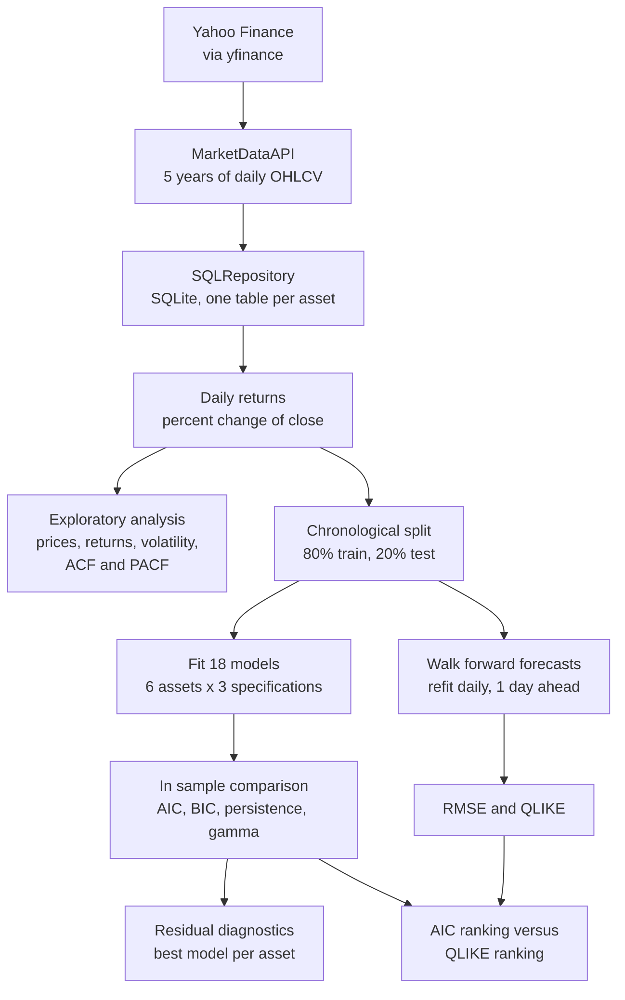
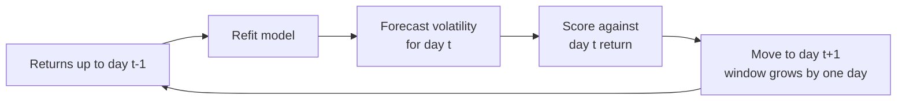

# Cross-Asset Volatility Forecasting with GARCH Models

A comparison of three GARCH family models, GARCH(1,1), EGARCH(1,1) and GJR-GARCH(1,1), for forecasting the daily volatility of three large cap equities (`AAPL`, `JPM`, `XOM`) and three cryptocurrencies (`BTC-USD`, `ETH-USD`, `SOL-USD`). The models are fitted in sample, compared on AIC and BIC, and then tested out of sample with walk forward one day ahead forecasts.

The whole analysis is in one notebook, [`notebooks/cross-asset-volatility-forecasting.ipynb`](notebooks/cross-asset-volatility-forecasting.ipynb).

## Research questions

1. Is volatility more persistent in equities or in cryptocurrencies?
2. Do asymmetric models (EGARCH and GJR-GARCH) outperform standard GARCH, and does this depend on the asset class?
3. Does the model with the best in sample fit (AIC) also give the best out of sample forecasts?

## Highlights

- **One extraction class for both asset classes.** `MarketDataAPI` wraps `yfinance` and returns the same clean OHLCV DataFrame for stocks and cryptocurrencies.
- **SQLite storage layer.** `SQLRepository` writes one table per asset and reads it back, so later steps do not call the API again.
- **18 fitted models.** Three specifications on each of six assets, using the first 80% of each return series.
- **Out of sample validation.** Walk forward refitting with one day ahead forecasts on the last 20%, scored with RMSE and QLIKE.
- **Runs on CPU.** No GPU is needed. The walk forward step is the slow part because it refits every model at every test day.

## Pipeline architecture



### Walk forward validation



## Method

| Step | What happens |
|---|---|
| Data collection | Five years of daily prices through `MarketDataAPI`, with structure checks on every asset |
| Storage | One SQLite table per ticker, read back to compute daily percentage returns |
| Exploration | Prices, returns, return histograms, annualised volatility, squared returns, ACF and PACF |
| Split | Chronological 80/20 split per asset (1,002 and 251 days for equities, 1,460 and 365 for cryptocurrencies) |
| Modelling | GARCH, EGARCH and GJR-GARCH with `p=1`, `q=1`, fitted with the `arch` package |
| Comparison | AIC, BIC, log likelihood, persistence by specification and the asymmetry parameter gamma |
| Diagnostics | Standardised residuals, their distribution and the ACF of their squares for the best model per asset |
| Validation | Walk forward one day ahead forecasts, scored with RMSE (against absolute returns) and QLIKE (against squared returns) |

## Results from the saved run

Results use the data downloaded when the saved run was made (September 2026), so a new run will differ slightly.

**Annualised volatility**

| Asset | Class | Annualised volatility |
|---|---|---|
| SOL-USD | Crypto | 78.4% |
| ETH-USD | Crypto | 57.7% |
| BTC-USD | Crypto | 43.0% |
| AAPL | Equity | 28.0% |
| XOM | Equity | 26.7% |
| JPM | Equity | 24.4% |

**Best specification per asset**

| Asset | Best by AIC (in sample) | Best by QLIKE (out of sample) | Agree |
|---|---|---|---|
| AAPL | EGARCH | EGARCH | Yes |
| JPM | EGARCH | EGARCH | Yes |
| BTC-USD | EGARCH | GJR-GARCH | No |
| ETH-USD | GJR-GARCH | EGARCH | No |
| SOL-USD | GARCH | GJR-GARCH | No |
| XOM | GARCH | EGARCH | No |

**Main findings**

- **Persistence (question 1).** Mean persistence is higher for cryptocurrencies under GARCH (0.945 against 0.911) and GJR-GARCH (0.945 against 0.918), and lower under EGARCH (0.881 against 0.967). Persistence is defined differently for each specification, so the comparison is only meaningful within one.
- **Asymmetry (question 2).** Asymmetric models had the lowest AIC for `AAPL`, `JPM`, `BTC-USD` and `ETH-USD`, ahead of GARCH by 21 to 43 AIC points. GARCH was best for `SOL-USD` and `XOM`, where GJR-GARCH was within 0.1 and 2 AIC points. The leverage effect is clearest for `AAPL` and `JPM` (GJR gamma 0.145 and 0.223), weaker for the cryptocurrencies (0.039 to 0.086) and absent for `XOM`.
- **In sample against out of sample (question 3).** The two rankings agree for only 2 of 6 assets. Standard GARCH was never the best out of sample. RMSE picks the same model as QLIKE for 4 of 6 assets, and differs for `JPM` (GARCH) and `XOM` (GJR-GARCH).
- **The differences are small.** The QLIKE gap between the best and second best model is 0.002 to 0.011 for five assets and 0.035 for `ETH-USD`. No significance test was run, so the out of sample ranking should not be over interpreted.

## Repository contents

```
.
├── notebooks/
│   └── cross-asset-volatility-forecasting.ipynb   # full analysis
└── README.md
```

## Getting started

### Run on Kaggle (recommended)

1. **Import the notebook.** In Kaggle, choose File, then Import Notebook, and upload `notebooks/cross-asset-volatility-forecasting.ipynb`.
2. **Turn on Internet.** Step 1 installs `arch`, and Step 2 downloads prices from Yahoo Finance.
3. **Run all cells.** No GPU is needed. Set `MAX_TEST_DAYS` in Step 8 to a small number such as 60 for a quick run, or leave it as `None` for the full test window, which can take tens of minutes.

### Run locally

1. Install the dependencies (Python 3.10 or newer):

   ```bash
   pip install arch yfinance pandas numpy matplotlib statsmodels jupyter
   ```

2. Open the notebook with Jupyter and run all cells. Remove the `%pip install arch` line in Step 1 if the package is already installed.

## Configuration

| Setting | Where | Default |
|---|---|---|
| Equity and crypto tickers | Step 2 | `AAPL`, `JPM`, `XOM` and `BTC-USD`, `ETH-USD`, `SOL-USD` |
| History length (`period`) | Step 2 | 5 years |
| Train share | Step 5 | 80% |
| Model orders `p` and `q` | Steps 6 and 8 | 1 and 1 |
| `MAX_TEST_DAYS` | Step 8 | `None` (full test window) |

## Limitations

- **Data changes with the download date.** Prices come from Yahoo Finance at run time, so numbers shift slightly between runs.
- **One split and one horizon.** Results rely on a single chronological split and one day ahead forecasts.
- **Different calendars.** Equities have about 251 trading days a year and cryptocurrencies trade every day. Annualised figures use 252 days for both, so the cryptocurrency figures are conservative.
- **Persistence is not directly comparable across specifications.** It is defined differently for GARCH, GJR-GARCH and EGARCH.
- **No significance testing.** The QLIKE gaps between models are small and were not tested.
- **Returns only.** The models use daily close to close returns and no other information.

## Acknowledgements

Built with the [`arch`](https://github.com/bashtage/arch) package and data from Yahoo Finance through [`yfinance`](https://github.com/ranaroussi/yfinance). Extends coursework from the WorldQuant University Applied Data Science Lab.
